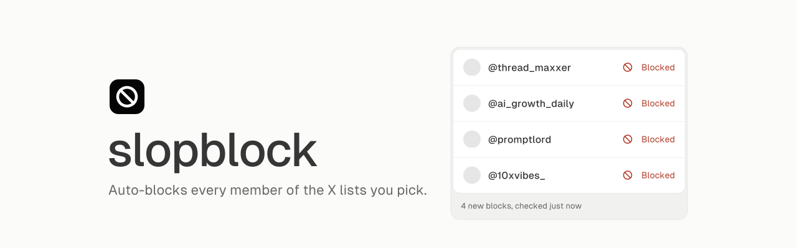
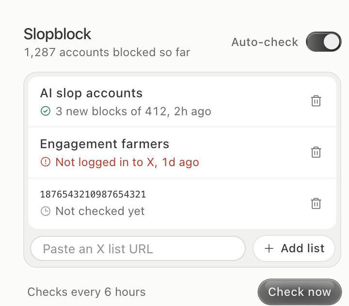

<p align="center">
  <picture>
    <source media="(prefers-color-scheme: dark)" srcset=".github/assets/banner-dark.svg">
    
  </picture>
</p>

<p align="center">A Chrome extension that blocks every member of the X lists you pick, then checks again every 6 hours.</p>

<p align="center">
  
  
  <a href="LICENSE"></a>
</p>

Someone already curated a list of the accounts you never want to see. Slopblock blocks every account on that list, from your own logged-in session. When the list owner adds more accounts, Slopblock blocks them on its next check.

<p align="center">
  <picture>
    <source media="(prefers-color-scheme: dark)" srcset=".github/assets/popup-dark.png">
    
  </picture>
  <br>
  <sub>The popup, shown with sample data.</sub>
</p>

## Install

Slopblock is not in the Chrome Web Store. Load it from source:

1. Clone the repository.

   ```sh
   git clone https://github.com/hridaya423/slopblock.git
   ```

2. Open `chrome://extensions` and turn on **Developer mode**.
3. Click **Load unpacked** and select the `slopblock/extension` folder.
4. Log in to [x.com](https://x.com) in the same Chrome profile.

> [!WARNING]
> When you install Slopblock, it starts a check right away and blocks without asking. If you do not want the default list blocked, turn off **Auto-check** or remove the list before the check finishes.

## Usage

Click the Slopblock icon in the toolbar to open the popup.

| Action | What happens |
| --- | --- |
| **Add list** | Paste a list URL such as `https://x.com/i/lists/2116659176894071283`. Slopblock checks the new list at once. |
| **Remove** (trash icon) | Slopblock stops checking the list. It does not unblock accounts it already blocked. |
| **Auto-check** | When on, Slopblock checks every list every 6 hours. |
| **Check now** | Checks every list now, in a tab you can see. |

Each row shows the result of the last check: how many accounts it blocked, out of how many members, and when.

## Configuration

Slopblock stores its settings in `chrome.storage.local`. Two values live in code:

| Setting | Default | Where |
| --- | --- | --- |
| Check interval | 6 hours | `CHECK_EVERY_MINUTES` in [`extension/background.js`](extension/background.js) |
| List on first install | `2116659176894071283` | `DEFAULT_LISTS` in [`extension/background.js`](extension/background.js) |

## How it works

1. On each check, the background worker opens the list's members page in a background tab.
2. [`hook.js`](extension/hook.js) reads the page's own request for the member list. [`content.js`](extension/content.js) repeats that request with the next cursor until it has every member.
3. For each member that Slopblock has not blocked yet, `content.js` calls the same endpoint that X's own Block button calls. Blocks run one per second. When X returns a rate limit, Slopblock waits until the limit resets.
4. The tab closes when the last list is done.

Slopblock remembers the IDs it blocked, so a later check only blocks new members. It sends nothing anywhere except to x.com.

> [!NOTE]
> Slopblock depends on how x.com loads lists and blocks accounts. If X changes either, a check fails, and the popup shows the error on that list's row.

## Development

The extension is plain JavaScript with no build step. After you edit a file, click the reload icon on the Slopblock card in `chrome://extensions`.

| File | Role |
| --- | --- |
| [`background.js`](extension/background.js) | Schedules checks and runs the queue of lists. |
| [`hook.js`](extension/hook.js) | Runs in the page and captures X's list requests. |
| [`content.js`](extension/content.js) | Collects members and blocks them. |
| [`popup.html`](extension/popup.html), [`popup.js`](extension/popup.js), [`popup.css`](extension/popup.css) | The popup, styled with the [Glaze](https://design.how/systems/glaze) design system. |

## License

[MIT](LICENSE)
